# MenuQR

Cardápio digital e pedidos por QR Code para o restaurante fictício **Casa Oliva**.

> Projeto demonstrativo de portfólio. Não é um produto comercial: não há pagamento real, multi-tenant nem planos.

## Capturas de tela

Geradas pelo próprio app em execução (`npm run screenshots`), com dados do Supabase.

| Cardápio                                                    | Produto                                            | Complementos                                                          | Acompanhamento                                                   |
| ----------------------------------------------------------- | -------------------------------------------------- | --------------------------------------------------------------------- | ---------------------------------------------------------------- |
| 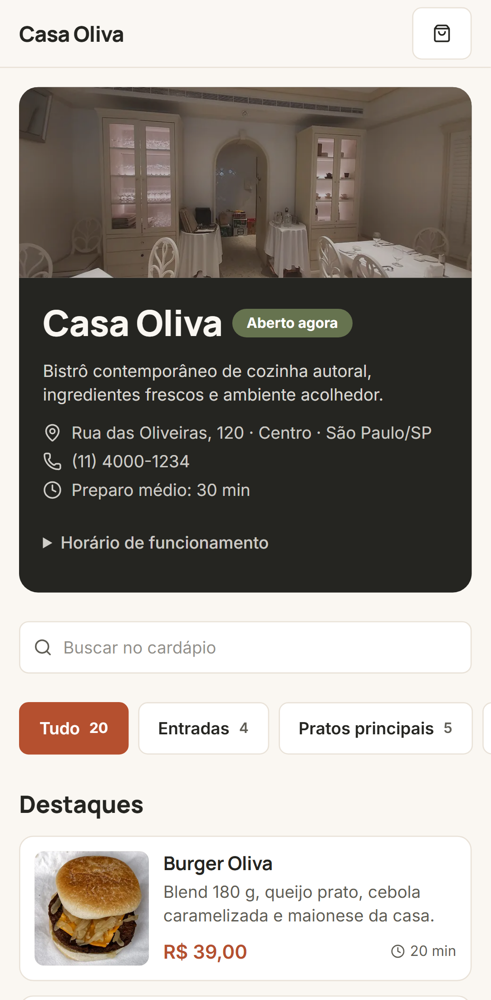 | 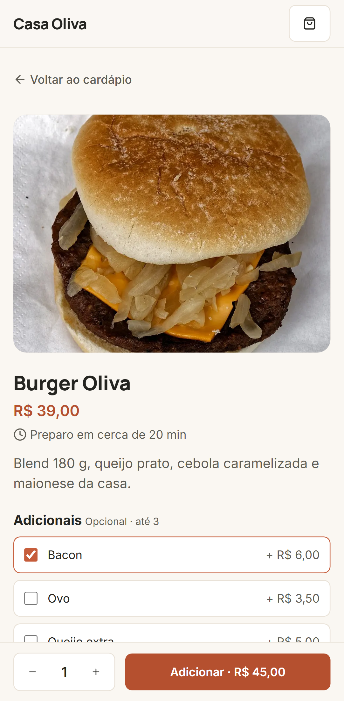 | 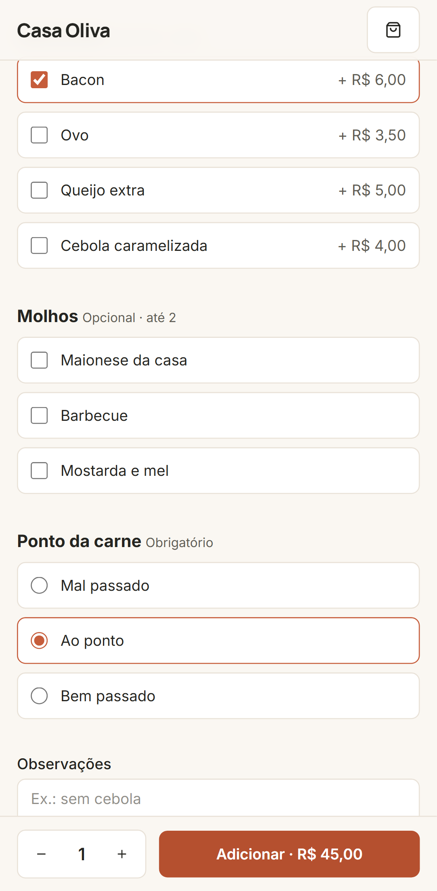 | 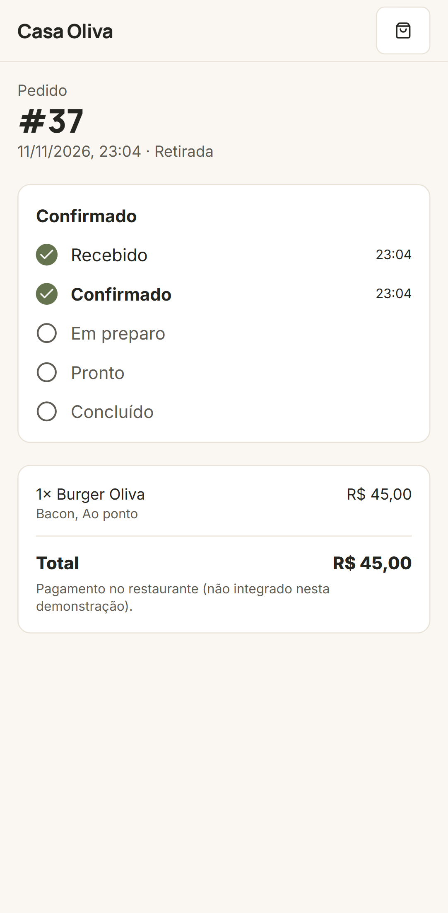 |

| Carrinho                                             | Checkout                                             |
| ---------------------------------------------------- | ---------------------------------------------------- |
| 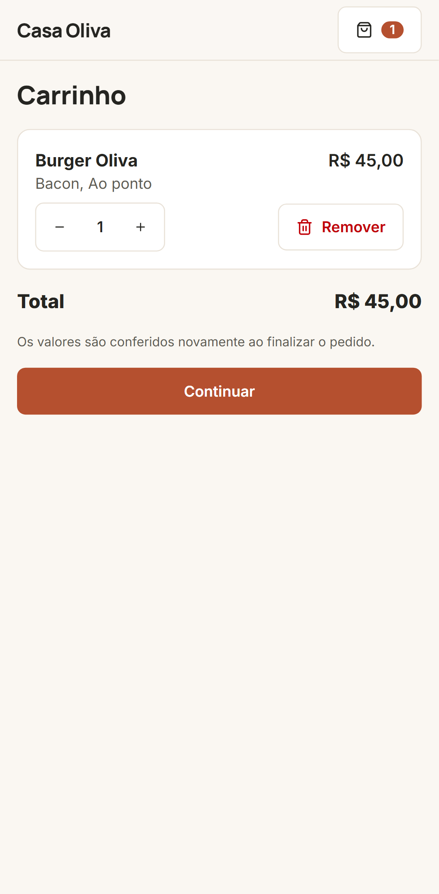 | 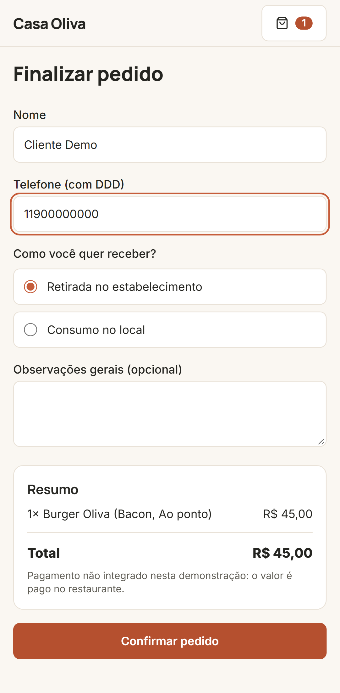 |

Painel administrativo (desktop e tablet):

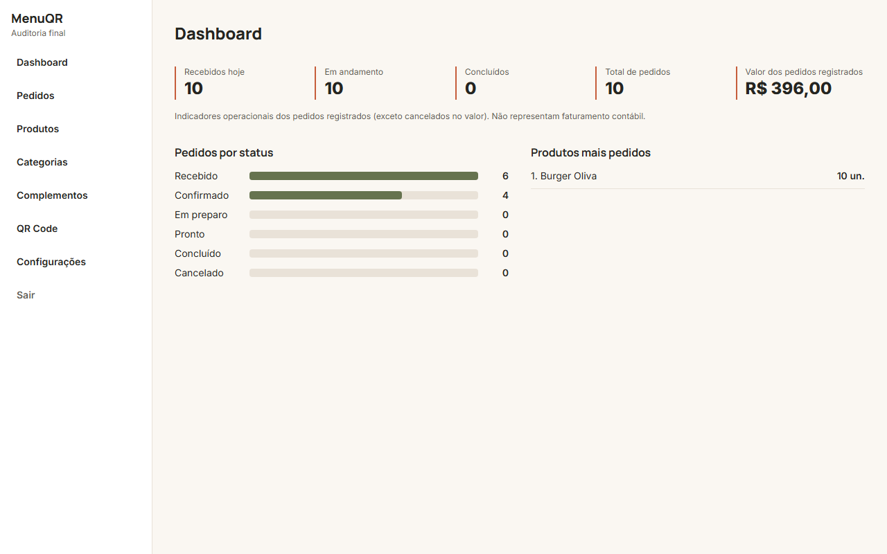
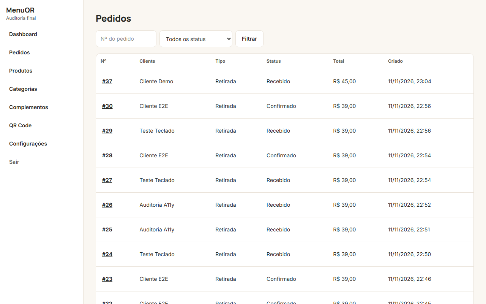
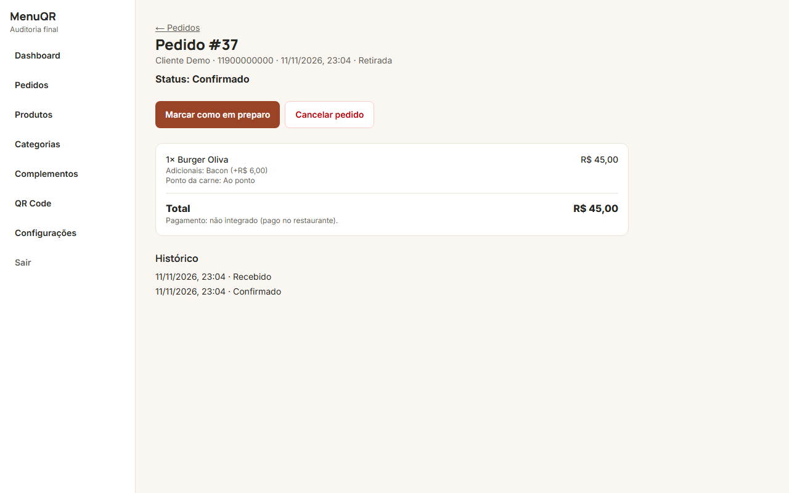
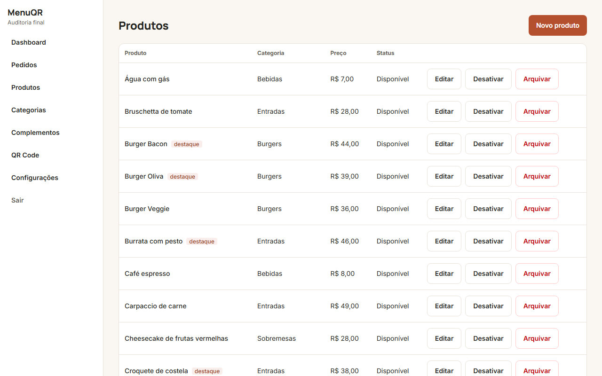
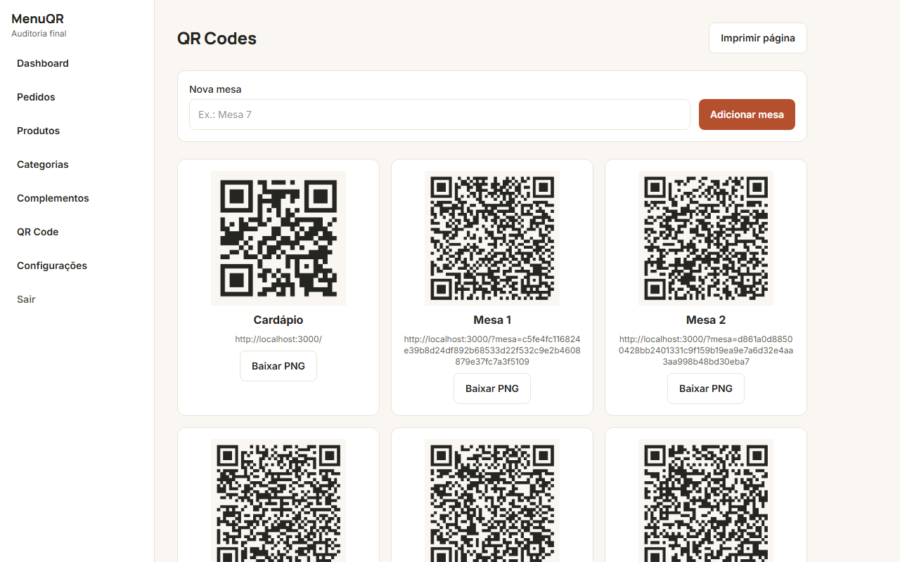
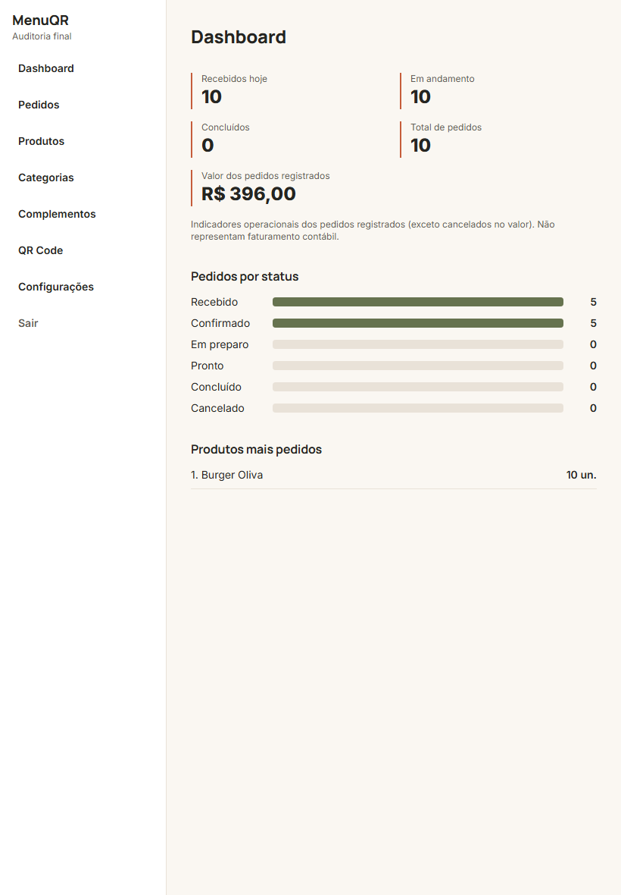

Também em `docs/screenshots`: home no desktop, login, complementos e configurações.

## O que resolve

O cliente lê o QR Code da mesa, monta o pedido no celular e acompanha o andamento. A equipe gerencia cardápio e pedidos em um painel.

## Funcionalidades

- Cardápio público com busca, categorias, destaques e indicador aberto/fechado (fuso America/Sao_Paulo).
- Produto com complementos obrigatórios ou opcionais, mínimo e máximo por grupo.
- Carrinho persistido no navegador. Checkout com retirada ou consumo no local.
- **Preços recalculados no servidor.** O cliente envia só IDs e quantidades.
- Acompanhamento por link com token aleatório (~244 bits), atualizado a cada 5 s.
- Painel admin: dashboard, pedidos com máquina de estados e histórico, produtos (upload de imagem, arquivamento), categorias, complementos, configurações, mesas e QR Codes (PNG e impressão).
- Supabase Auth, Row Level Security e gatilhos de banco que reforçam as transições de status.

## Tecnologias

Next.js 16 (App Router) · React 19 · TypeScript strict · Tailwind CSS 4 · Supabase (Postgres, Auth, Storage, RLS) · Zod · React Hook Form · Vitest · Playwright.

## Executar localmente

Requisitos: Node 24+ e um projeto Supabase (nuvem; o Supabase local exige Docker).

```powershell
npm install
Copy-Item .env.example .env.local   # preencha as variáveis
npm run dev
```

### Configurar o Supabase

1. Crie um projeto em supabase.com e copie URL, `anon key` e `service_role key` para `.env.local`.
2. No SQL Editor, execute **em ordem** os 3 arquivos de `supabase/migrations/` (`…000000_schema.sql`, `…000100_rls.sql`, `…000200_harden_public_read.sql`) e depois `supabase/seed.sql`. Cada arquivo uma vez, em uma aba vazia. (Ou use a CLI: `supabase link` e `supabase db push`.)
3. Em Authentication > Users, crie o usuário administrador (e-mail e senha) e promova-o:

```sql
insert into public.profiles (id, full_name, role)
select id, 'Administrador', 'admin' from auth.users where email = 'seu-email@exemplo.com';
```

4. Acesse `/admin/login`.
5. (Opcional) Fotos de demonstração: `npm run seed:images` baixa fotos do Wikimedia Commons, confere a licença, envia ao Storage e liga aos produtos. Créditos em [docs/IMAGE_CREDITS.md](docs/IMAGE_CREDITS.md).

Para ver o fluxo de mesa: em `/admin/qr-code`, abra o link de uma mesa (`/?mesa=<código>`).

## Testes

```powershell
npm run format:check
npm run lint
npm run typecheck
npm test            # unitários (Vitest), sem Supabase
npm run build

# Exigem um projeto Supabase de TESTE com migrations e seed:
$env:RLS_TEST_ALLOW="yes"; npm run test:rls   # políticas RLS com usuários reais
$env:E2E_ADMIN_EMAIL="..."; $env:E2E_ADMIN_PASSWORD="..."
npm run test:e2e                              # fluxos, teclado, responsividade, QR
npm run a11y                                  # axe-core em 17 telas
```

Detalhes, resultados e o que **não** foi verificado em [docs/TESTING.md](docs/TESTING.md) e [docs/FINAL_RELEASE_AUDIT.md](docs/FINAL_RELEASE_AUDIT.md).

## Documentação

[Arquitetura](docs/ARCHITECTURE.md) · [Banco](docs/DATABASE.md) · [Segurança](docs/SECURITY.md) · [Testes](docs/TESTING.md) · [Deploy](docs/DEPLOYMENT.md) · [Progresso](docs/IMPLEMENTATION_PROGRESS.md)

## Limitações conhecidas

- Sem pagamento. Pedidos ficam com pagamento "não integrado".
- Atualização do acompanhamento por polling, não por Supabase Realtime.
- Limite de requisições em memória (por instância). O IP só é lido de proxy declarado em `TRUSTED_PROXY` (veja [docs/SECURITY.md](docs/SECURITY.md)); a infraestrutura real não foi verificada.
- Verificado só com emulação de celular e tablet e por software (QR); sem dispositivos reais nem leitor de tela.
- As fotos são ilustrativas: algumas aproximam o prato (por exemplo, o "Croquete de costela" usa um croquete de abóbora e a "Bruschetta" usa pão com tomate). Troque pelas fotos do seu cardápio em `/admin/products`.

## Créditos

Fontes Inter e Manrope (SIL OFL) via Google Fonts. Ícones Lucide (ISC). Fotos do Wikimedia Commons (CC0, domínio público, CC BY e CC BY-SA), com autor e licença de cada uma em [docs/IMAGE_CREDITS.md](docs/IMAGE_CREDITS.md).

## Licença

MIT.
